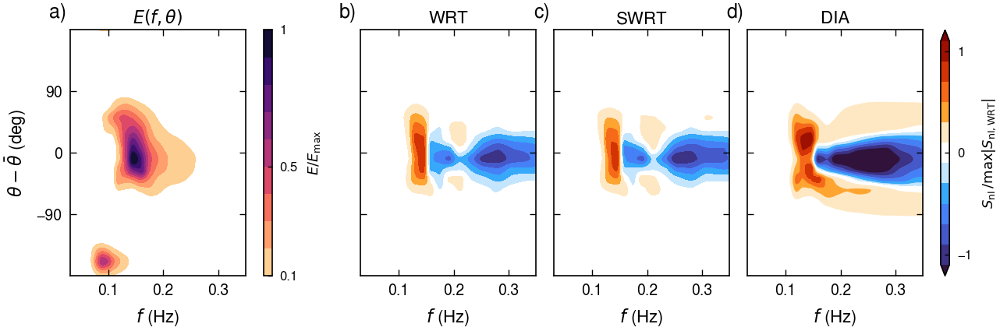
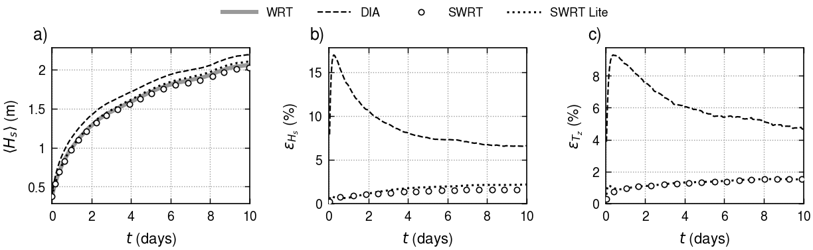
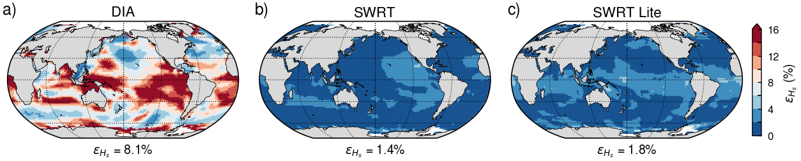
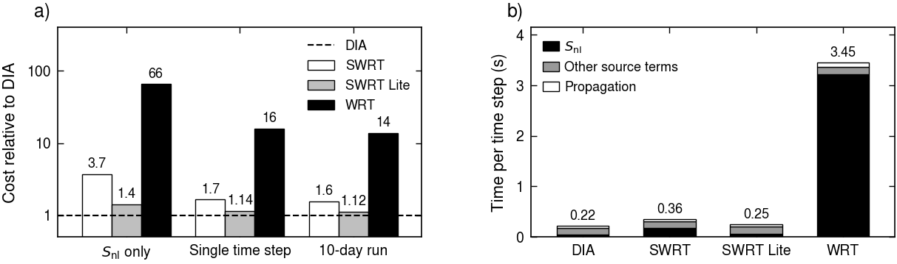

# SWRT for nonlinear four-wave interactions in ecWAM

SWRT (sparse Webb–Resio–Tracy) computes the nonlinear four-wave interactions S_nl from K configurations of the WRT
quadrature table, each a quadruplet and its mirror image, with one optimized coefficient per configuration. This patch adds
SWRT to ecWAM as an alternative to the Discrete Interaction Approximation (DIA) in `SNONLIN`. In a 24-h global test, SWRT
keeps H_s within 1 % of WRT, compared with 15 % for DIA, and takes 1.6 times the time per step of
DIA.

The SWRT files and this guide are on the branch `swrt` of
[Jialunx/ecwam](https://github.com/Jialunx/ecwam/tree/swrt/swrt), a fork of [ecmwf-ifs/ecwam](https://github.com/ecmwf-ifs/ecwam)
(ecWAM 1.5.14).

## 1. Changes to ecWAM

The patch adds one source file and changes eight others. The default `INLSCHEME = 0` leaves ecWAM unchanged.

| File | Change |
|---|---|
| `src/ecwam/snonlin_swrt.F90` (new) | `INISNONLIN_SWRT` reads the SWRT file and checks it against the spectral grid. `SNONLIN_SWRT` takes the arguments of `SNONLIN` and adds S_nl to `SL` and its diagonal term to `FLD`. |
| `src/ecwam/yowstat.F90` | Declares the switch `INLSCHEME`. |
| `src/ecwam/mpuserin.F90` | Reads `INLSCHEME` in namelist `NALINE`, 0 for DIA (default) and 1 for SWRT. |
| `src/ecwam/userin.F90` | Writes the scheme to `wam.log` and stops for other values. |
| `src/ecwam/initmdl.F90` | Calls `INISNONLIN_SWRT` when `INLSCHEME = 1`. |
| `src/ecwam/implsch.F90` | Calls `SNONLIN_SWRT` instead of `SNONLIN` in the source-term integration when `INLSCHEME = 1`. |
| `src/ecwam/wdfluxes.F90` | Calls `SNONLIN_SWRT` instead of `SNONLIN` for the wave-dependent fluxes at the initial time when `INLSCHEME = 1`. |
| `src/ecwam/CMakeLists.txt` | Adds the new file to the build. |
| `share/ecwam/scripts/ecwam_run_model.sh` | Passes `isnonlin`, `inlscheme` and `swrt_operator` of the yml settings to the namelist and the environment. |

The SWRT files hold the deep-water interactions, which `ISNONLIN` scales in shallow water as it scales DIA.
The diagonal term is the derivative of S_nl at a spectral bin with respect to the spectral density at that bin, taken
analytically as in `SNONLIN`. Each quadruplet of SWRT moves action from k_3 to k_1, both on the spectral grid, at a rate
proportional to T = n_1 n_3 (n_4 − n_2) + n_2 n_4 (n_3 − n_1), where n_i is the action density at k_i and n_2 and n_4 are
interpolated. Its diagonal term is proportional to ∂T/⁠∂n_1 at k_1 and to −∂T/⁠∂n_3 at k_3, as in the WRT code Xnl
(van Vledder 2006). SWRT adds diagonal terms only at k_1 and k_3, whereas DIA adds them also at the bins around its
interpolated wavenumbers.

## 2. Installation

The branch can be cloned directly (video guide in the release [swrt-video](https://github.com/Jialunx/ecwam/releases/tag/swrt-video)).

```bash
git clone -b swrt https://github.com/Jialunx/ecwam
```

An existing clone of ecWAM 1.5.14 takes the same changes from the patch.

```bash
git checkout 1.5.14
curl -LO https://raw.githubusercontent.com/Jialunx/ecwam/swrt/swrt/ecwam_swrt.patch
git apply ecwam_swrt.patch
```

ecWAM then builds as before and needs no new library. The SWRT files are in the folder `swrt/files` of the branch and go
to any directory the model can read. The files for the other spectral grids of section 3 are in the same folder.

```bash
curl -LO https://raw.githubusercontent.com/Jialunx/ecwam/swrt/swrt/files/swrt_ec4x_K31L13.ww3op
curl -LO https://raw.githubusercontent.com/Jialunx/ecwam/swrt/swrt/files/wrt_table_K807.ww3op
```

| SWRT file | Configurations | Offsets | Use |
|---|---|---|---|
| `swrt_ec4x_K31L13.ww3op` | 31 | 13 | runs with SWRT, selected for four times the S_nl cost of DIA |
| `wrt_table_K807.ww3op` | 807 | 74 | reference runs with WRT, all configurations with coefficient 1 |

<!-- web -->
The video explains each step in captions, from the clone of the branch to the first 6 h of a 48-h run of the global test of
section 5.2 with `swrt_ec4x_K31L13.ww3op`.

https://github.com/user-attachments/assets/4d1b0eef-1720-4f88-87b2-023dd6bf87d8

<!-- /web -->

The run in the video edits the yml file of the regression test `etopo1_oper_an_fc_O48` of ecWAM to the settings below.

| Setting | yml | Value |
|---|---|---|
| Spatial grid | `grid` | O48, global, about 1.9° |
| Directions | `directions` | 36 |
| Frequencies | `frequencies` | 29 propagated, of NFRE = 36 |
| First frequency | `fr1`, `ifre1` | 0.0345 Hz, from fr1 = 4.177248E-02 Hz at ifre1 = 3 |
| Time step | `timestep` | 900 s for propagation and source terms |
| Physics | `iphys` | 1 |
| S_nl | `inlscheme`, `isnonlin`, `swrt_operator` | SWRT with `swrt_ec4x_K31L13.ww3op`, isnonlin = 0 |
| Period | `analysis.begin`, `forecast.end` | 12 UTC 31 December 2022 to 12 UTC 2 January 2023, 48 h |
| Forcing | `forcings` | ECMWF operational 10-m winds and sea ice, analyses every 6 h to 00 UTC 1 January 2023, then forecasts every hour |
| Validation | `validation` | removed, as it checks the results of DIA |

## 3. Spectral grid

The SWRT files depend on the spectral grid only. The spectral grid of ecWAM is set by the number of directions, the number NFRE of
frequencies, and the reference frequency fr1 of bin ifre1, and its frequency ratio is fixed at 1.1. NFRE is the number of
frequencies of the source terms, whereas `frequencies` in the yml file sets the number of propagated frequencies. The branch holds
SWRT files for the common spectral grids below, each already optimized for about four times the S_nl cost of DIA.

<!-- compact -->

| SWRT file | Directions × NFRE | First frequency (Hz) | Ratio |
|---|---|---|---|
| `swrt_ec4x_K31L13.ww3op` | 36 × 36 | 0.0345 | 1.1 |
| `swrt_d24_f0345_K27L16.ww3op` | 24 × 36 | 0.0345 | 1.1 |
| `swrt_d24_n30_f0345_K29L14.ww3op` | 24 × 30 | 0.0345 | 1.1 |
| `swrt_d24_n40_f0345_K27L16.ww3op` | 24 × 40 | 0.0345 | 1.1 |
| `swrt_d12_f0418_K29L14.ww3op` | 12 × 36 | 0.0418 | 1.1 |
| `swrt_d24_f0418_K27L16.ww3op` | 24 × 36 | 0.0418 | 1.1 |
| `swrt_d36_f055_K29L14.ww3op` | 36 × 36 | 0.055 | 1.1 |

A run names the file of its spectral grid in `swrt_operator` (section 4), and the model stops with a message when the file and the
grid differ. The scripts in `tools/` of the SWRT code archive
([doi:10.5281/zenodo.23654016](https://doi.org/10.5281/zenodo.23654016)) build a file for any other spectral grid in about an
hour.

## 4. Running

| Setting | Where | Value |
|---|---|---|
| `INLSCHEME` | namelist `NALINE` | 1 for SWRT, 0 for DIA (default) |
| `WAM_SWRT_OPERATOR` | environment | path of the SWRT file |
| `ISNONLIN` | namelist `NALINE` | shallow-water scaling 0, 1 or 2, as for DIA |
| `WAM_SWRT_DIAG` | environment | `0` switches the diagonal term off (optional) |

The standalone scripts read the same settings from three lines of the yml file.

```yaml
physics:
    inlscheme: 1
    isnonlin: 0
    swrt_operator: /abs/path/swrt_ec4x_K31L13.ww3op
```

The log file `wam.log` names the scheme, the SWRT file, and its numbers of configurations and offsets. The model stops with a
message when the variable is unset or the file is missing.

## 5. Test results

### 5.1 Synthetic and ERA5 spectra

The error ε of the direction-integrated S_nl (van Vledder 2006, Eq. 58) is computed against WRT on 300 synthetic spectra
that were not used in the selection, half of them single-peaked and half bimodal. SWRT follows WRT closely, whereas the
error of DIA exceeds the magnitude of S_nl itself.

| Method | Median ε (%) | 95th percentile of ε (%) |
|---|---|---|
| SWRT with K = 31 | 8 | 18 |
| DIA of ecWAM | 125 | 190 |

ERA5 spectra exist only on the grid of ERA5, 24 directions and 30 frequencies, and are tested with the ERA5 file of section 3.
Over 1171 deep-water ERA5 spectra on a 5° grid at 00 UTC 1 January 2019, the median ε is 8 % for SWRT and 72 % for DIA. In an example of a
wind sea with a swell, with ε of 8 % for SWRT and 55 % for DIA, SWRT reproduces the transfer of WRT in frequency and direction,
whereas DIA overestimates its largest value by a factor of 1.6 and adds transfer at directions where WRT has none (Fig. 1).



**Fig. 1.** An ERA5 spectrum of a wind sea with a swell at 35° S, 155° E, 00 UTC 1 January 2019. (a) E(f, θ) / E_max;
(b)–(d) S_nl(f, θ) from WRT, SWRT and DIA, divided by the largest |S_nl| of WRT. Directions are relative to the mean direction θ̄.

### 5.2 Global test

The global test extends the regression case `etopo1_oper_an_fc_O48` of ecWAM to 24 h on the operational spectral grid of 36 × 36, of which 29 frequencies are propagated, from
12 UTC 31 December 2022 to 12 UTC 1 January 2023. It starts from rest with the ECMWF operational 10-m winds and sea ice, the
physics of iphys = 1 and time steps of 900 s. The errors ε_Hs and ε_Tz are the relative differences from the run with WRT,
summed over the hourly outputs from t = 1 h and over the sea points where H_s of WRT is at least 0.1 m.

| Method | ε_Hs (%) | ε_Tz (%) | Mean H_s at 24 h (m) |
|---|---|---|---|
| WRT | – | – | 1.20 |
| SWRT with K = 31 | 0.7 | 0.8 | 1.19 |
| DIA | 15 | 9 | 1.35 |

SWRT keeps H_s within 1 % of WRT at every hour and nearly everywhere, while DIA gives 15 % higher
values (Figs. 2 and 3).



**Fig. 2.** Global statistics of the 24-h ecWAM test with S_nl from WRT (thick gray line), DIA (dashed) and SWRT with K = 31
(circles). (a) Mean H_s over the sea points; (b) ε_Hs and (c) ε_Tz at each hour.



**Fig. 3.** ε_Hs at each sea point over the 24-h ecWAM test for (a) DIA and (b) SWRT with K = 31, with ε_Hs over all points
under each map. Seas without a value are white, mostly the ice-covered polar seas.

### 5.3 Cost

The cost is measured with DR_HOOK in the optimized build of the 24-h runs, on one of four MPI tasks, and is given relative to
DIA. WRT runs through the same vectorized routine as SWRT, and the difference in cost therefore comes from the numbers of
configurations and offsets alone.

| Method | S_nl | Time step | Run |
|---|---|---|---|
| SWRT with K = 31 | 4.0 | 1.6 | 1.4 |
| WRT | 68 | 14 | 11 |

S_nl takes about a fifth of a time step with DIA, half with SWRT and nearly all of it with WRT (Fig. 4).



**Fig. 4.** Cost of S_nl in the 24-h ecWAM test. (a) Cost of SWRT with K = 31 (white) and WRT (black) relative to DIA (dashed
line) for one S_nl call, one time step and the run; (b) time per time step, split into S_nl, the other source terms and
propagation.
