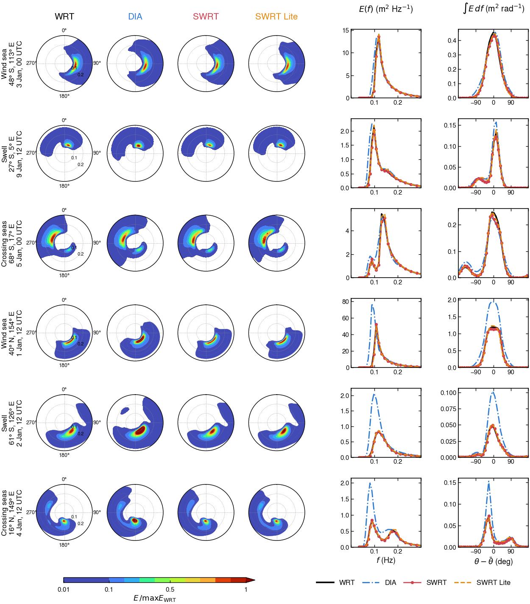
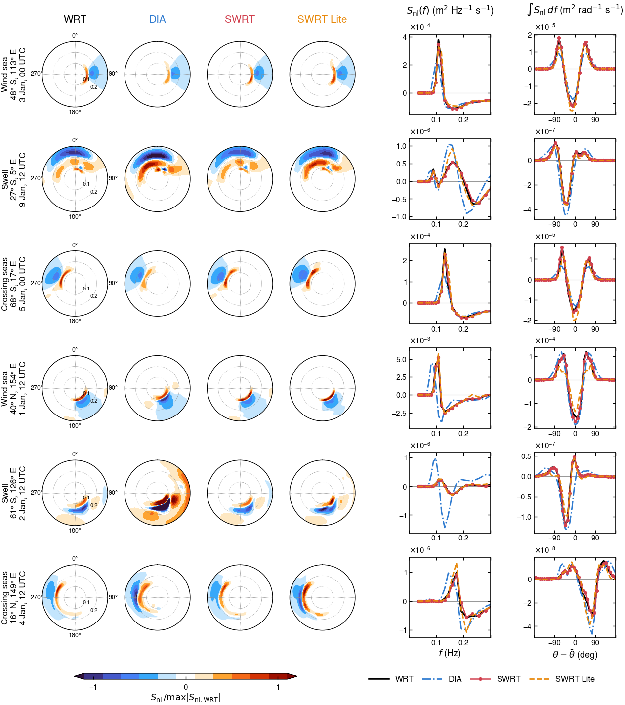

# SWRT for nonlinear four-wave interactions in ecWAM

SWRT (sparse Webb–Resio–Tracy) computes the nonlinear four-wave interactions S_nl from K configurations of the WRT
quadrature table, each a quadruplet and its mirror image, with one optimized coefficient per configuration. SWRT is implemented
in ecWAM's `SNONLIN` as an option next to the Discrete Interaction Approximation (DIA). Two files of configurations are
provided for each grid: SWRT with 31 configurations, and SWRT Lite with 7, which is faster.

The SWRT files and this guide are on the branch `swrt` of
[Jialunx/ecwam](https://github.com/Jialunx/ecwam/tree/swrt/swrt), a fork of [ecmwf-ifs/ecwam](https://github.com/ecmwf-ifs/ecwam)
(ecWAM 1.5.14).

## 1. Changes to ecWAM

The patch adds one source file and changes eight others. The default `INLSCHEME = 0` leaves ecWAM unchanged.

| File | Change |
|---|---|
| `src/ecwam/snonlin_swrt.F90` (new) | `INISNONLIN_SWRT` reads the SWRT file and checks it against the spectral grid. `SNONLIN_SWRT` takes the arguments of `SNONLIN` and adds S_nl to `SL` and its diagonal term to `FLD`. |
| `src/ecwam/yowstat.F90` | Declares the switch `INLSCHEME`. |
| `src/ecwam/mpuserin.F90` | Reads `INLSCHEME` in namelist `NALINE`, 0 for DIA (default) and 1 for SWRT. |
| `src/ecwam/userin.F90` | Writes the scheme to `wam.log` and stops for other values. |
| `src/ecwam/initmdl.F90` | Calls `INISNONLIN_SWRT` when `INLSCHEME = 1`. |
| `src/ecwam/implsch.F90` | Calls `SNONLIN_SWRT` instead of `SNONLIN` in the source-term integration when `INLSCHEME = 1`. |
| `src/ecwam/wdfluxes.F90` | Calls `SNONLIN_SWRT` instead of `SNONLIN` for the wave-dependent fluxes at the initial time when `INLSCHEME = 1`. |
| `src/ecwam/CMakeLists.txt` | Adds the new file to the build. |
| `share/ecwam/scripts/ecwam_run_model.sh` | Passes `isnonlin`, `inlscheme` and `swrt_operator` of the yml settings to the namelist and the environment. |

## 2. Installation

The branch can be cloned directly (video guide in the release [swrt-video](https://github.com/Jialunx/ecwam/releases/tag/swrt-video)).

```bash
git clone -b swrt https://github.com/Jialunx/ecwam
```

An existing clone of ecWAM 1.5.14 takes the same changes from the patch.

```bash
git checkout 1.5.14
curl -LO https://raw.githubusercontent.com/Jialunx/ecwam/swrt/swrt/ecwam_swrt.patch
git apply ecwam_swrt.patch
```

ecWAM then builds as before and needs no new library. The SWRT files are in the folder `swrt/files` of the branch and go
to any directory the model can read. The files for the other spectral grids of section 3 are in the same folder.

```bash
curl -LO https://raw.githubusercontent.com/Jialunx/ecwam/swrt/swrt/files/swrt_ec4x_K31L13.ww3op
curl -LO https://raw.githubusercontent.com/Jialunx/ecwam/swrt/swrt/files/swrt_ec_K7L7.ww3op
curl -LO https://raw.githubusercontent.com/Jialunx/ecwam/swrt/swrt/files/wrt_table_K807.ww3op
```

| SWRT file | Configurations | Offsets | Use |
|---|---|---|---|
| `swrt_ec4x_K31L13.ww3op` | 31 | 13 | runs with SWRT, 3.7 times the S_nl cost of DIA |
| `swrt_ec_K7L7.ww3op` | 7 | 7 | faster runs with SWRT Lite, 1.4 times the S_nl cost of DIA |

<!-- web -->
The video explains each step in captions, from the clone of the branch to the first 6 h of a 48-h run of the ecWAM test case
`etopo1_oper_an_fc_O48` on the spectral grid of section 5.1 with `swrt_ec4x_K31L13.ww3op`.

https://github.com/user-attachments/assets/4d1b0eef-1720-4f88-87b2-023dd6bf87d8

<!-- /web -->

## 3. Spectral grid

Each SWRT file fits one spectral grid: the number of directions, the number NFRE of source-term frequencies and the frequency
fr1 of bin ifre1 (the frequency ratio is always 1.1). 7 common grid settings for SWRT have been optimized and are ready to use.

<!-- compact -->

| Directions × NFRE | First frequency (Hz) | SWRT file (K = 31) | SWRT Lite file (K = 7) |
|---|---|---|---|
| 36 × 36 | 0.0345 | `swrt_ec4x_K31L13.ww3op` | `swrt_ec_K7L7.ww3op` |
| 24 × 36 | 0.0345 | `swrt_d24_f0345_K31L13.ww3op` | `swrt_d24_f0345_K7L7.ww3op` |
| 24 × 30 | 0.0345 | `swrt_d24_n30_f0345_K31L13.ww3op` | `swrt_d24_n30_f0345_K7L7.ww3op` |
| 24 × 40 | 0.0345 | `swrt_d24_n40_f0345_K31L13.ww3op` | `swrt_d24_n40_f0345_K7L7.ww3op` |
| 12 × 36 | 0.0418 | `swrt_d12_f0418_K31L13.ww3op` | `swrt_d12_f0418_K7L7.ww3op` |
| 24 × 36 | 0.0418 | `swrt_d24_f0418_K31L13.ww3op` | `swrt_d24_f0418_K7L7.ww3op` |
| 36 × 36 | 0.055 | `swrt_d36_f055_K31L13.ww3op` | `swrt_d36_f055_K7L7.ww3op` |

A run names the file of its spectral grid in `swrt_operator` (section 4).
For any other spectral grid, `swrt/tools/make_swrt_files.sh` builds both files, in 16 minutes for 24 × 36. Each file is the
most accurate set on synthetic training spectra that stays stable when S_nl alone is integrated in time.

## 4. Running

| Setting | Where | Value |
|---|---|---|
| `INLSCHEME` | namelist `NALINE` | 1 for SWRT, 0 for DIA (default) |
| `WAM_SWRT_OPERATOR` | environment | path of the SWRT file |
| `ISNONLIN` | namelist `NALINE` | shallow-water scaling 0, 1 or 2, as for DIA |
| `WAM_SWRT_DIAG` | environment | `0` switches the diagonal term off (optional) |

The scripts read the same settings from three lines of the yml file.

```yaml
physics:
    inlscheme: 1
    isnonlin: 0
    swrt_operator: /abs/path/swrt_ec4x_K31L13.ww3op
```

## 5. Test results

### 5.1 Global test

The global test runs the ecWAM test case `etopo1_era5_O48` for ten days with the settings below, once with each S_nl. It is a
cold start: the initial spectra are JONSWAP spectra computed from the local wind.

| Setting | yml | Value |
|---|---|---|
| Spatial grid | `grid` | O48, global, about 1.9° |
| Directions | `directions` | 36 |
| Frequencies | `frequencies` | 29 propagated, of NFRE = 36 |
| First frequency | `fr1`, `ifre1` | 0.0345 Hz, from fr1 = 4.177248E-02 Hz at ifre1 = 3 |
| Time step | `timestep` | 900 s for propagation and source terms |
| Physics | `iphys` | 1, ST4 (Ardhuin et al. 2010) |
| S_nl | `inlscheme`, `isnonlin`, `swrt_operator` | inlscheme = 1 with the file of WRT, SWRT or SWRT Lite, or 0 for DIA; isnonlin = 0 |
| Period | `begin`, `end` | 00 UTC 1 January 2025 to 00 UTC 11 January 2025, 10 days |
| Forcing | `forcings` | ERA5 10-m winds and sea ice every hour |

| Method | ε_Hs (%) | ε_Tz (%) | Mean H_s at 10 days (m) |
|---|---|---|---|
| WRT | – | – | 2.06 |
| SWRT | 1.4 | 1.3 | 2.03 |
| SWRT Lite | 1.8 | 1.4 | 2.10 |
| DIA | 8.1 | 6.0 | 2.19 |

ε_Hs and ε_Tz are ε_X = Σ |X − X_WRT| / Σ X_WRT for X = H_s and T_z, with the sums over the hourly outputs from t = 1 h and over
the sea points where H_s of WRT is at least 0.1 m.


**Fig. 1.** Global statistics of the 10-day test on the grid of 36 × 36, with S_nl from WRT (thick gray line),
DIA (dashed), SWRT (circles) and SWRT Lite (dotted). (a) Mean H_s over the sea points; (b) ε_Hs and (c) ε_Tz at each hour.


**Fig. 2.** ε_Hs at each sea point over the ten days for (a) DIA, (b) SWRT and (c) SWRT Lite, with ε_Hs over all points.

### 5.2 Cost

Cost relative to DIA.

| Method | S_nl only | Single time step | 10-day run |
|---|---|---|---|
| DIA | 1 | 1 | 1 |
| SWRT | 3.7 | 1.7 | 1.6 |
| SWRT Lite | 1.4 | 1.14 | 1.12 |
| WRT (vectorized) | 66 | 16 | 14 |


**Fig. 3.** Cost of S_nl in the global test. (a) Cost of SWRT (white), SWRT Lite (gray) and WRT (black) relative to DIA
(dashed line) for S_nl only, a single time step and the 10-day run; (b) time per time step, split into S_nl, the other source terms and
propagation.

### 5.3 Other spectral grids

Each file of section 3 run in the global test on its own spectral grid, against WRT on the same grid. Each cell gives
SWRT / SWRT Lite / DIA, in %.

| Directions × NFRE | First frequency (Hz) | ε_Hs | ε_Tz |
|---|---|---|---|
| 36 × 36 | 0.0345 | 1.4 / 1.8 / 8.1 | 1.3 / 1.4 / 6.0 |
| 24 × 36 | 0.0345 | 0.5 / 2.2 / 10 | 0.6 / 2.0 / 7.0 |
| 24 × 30 | 0.0345 | 0.9 / 4.0 / 15 | 0.9 / 3.6 / 10 |
| 24 × 40 | 0.0345 | 0.5 / 3.4 / 9.5 | 0.6 / 2.1 / 7.0 |
| 12 × 36 | 0.0418 | 0.6 / 2.6 / 18 | 0.4 / 1.8 / 10 |
| 24 × 36 | 0.0418 | 1.7 / 2.1 / 9.7 | 1.6 / 2.0 / 6.9 |
| 36 × 36 | 0.055 | 0.7 / 1.1 / 7.2 | 0.7 / 0.9 / 5.7 |

### 5.4 Example spectra over ten days



**Fig. 4.** Wave spectra of two wind seas, two swells and two crossing seas in the 10-day test. Left: E(f, θ) divided by the
maximum of WRT; right: E(f) and the directional distribution ∫E df.



**Fig. 5.** S_nl of the spectra of Fig. 4. Left: S_nl(f, θ) divided by the largest |S_nl| of WRT; right: S_nl(f) and
∫S_nl df.
